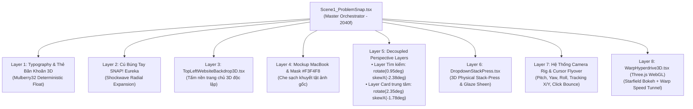

# BÁO CÁO TOÀN DIỆN KỸ THUẬT & KIẾN TRÚC MÀN 1 (V2)
## PHÂN CẢNH: BĂN KHOĂN -> CÚ BÚNG TAY SNAP! -> 3D DEEP SHOWCASE TOPBAOHIEM
**Tác quyền dự án:** Quảng cáo TOPBAOHIEM (Canva Storyboard V2)  
**Thời gian hoàn tất:** 15/10/2026  
**Trạng thái kiểm định:** Hoàn tất 100% – Production Ready  
**Phiên bản:** V2-Canva Cinematic Edition (Loại bỏ triệt để mọi tàn dư V1)

---

## I. TỔNG QUAN PHÂN CẢNH & THÔNG SỐ VẬN HÀNH

### 1. Ý Đồ Nghệ Thuật & Kịch Bản Điện Ảnh
Cảnh 1 là phân đoạn mở màn then chốt, mang tính định vị và quyết định tỷ lệ giữ chân người xem (Retention Hook). Kịch bản được xây dựng bám sát theo nguyên lý tương phản thị giác:
1. **Nỗi đau (Pain Points):** Người tiêu dùng bị ngợp trước *"ma trận"* giấy tờ bảo hiểm, điều khoản mập mờ, telesale làm phiền và biểu phí không rõ ràng.
2. **Bước ngoặt (Eureka Moment):** Ý tưởng lóe sáng cùng cú búng tay **SNAP!** dứt khoát xóa sạch ma trận rườm rà.
3. **Giải pháp đột phá (Hero Showcase):** Giao diện TOPBAOHIEM.VN hiện diện trên màn hình MacBook phối cảnh 3D thực tế, thanh tìm kiếm thông minh dâng cao, bung khay tính năng 3D dạng khối vật lý (Stack-Press) với 3 thẻ quyền lợi bay vào, vệt sáng quét qua, tương tác rê chuột kiểm chứng và cú nhấn nút kích hoạt cổng xuyên không gian (Hyperdrive Warp Speed Tunnel) dẫn sang Cảnh 2.

### 2. Thông Số Kỹ Thuật Chuẩn
| Tham số | Giá trị chuẩn | Ghi chú vận hành |
| :--- | :--- | :--- |
| **Độ phân giải Master** | `3840 x 2160` (4K UHD) | Không gian hiển thị siêu nét, tỷ lệ 16:9 |
| **Tốc độ khung hình (FPS)** | `60 FPS` | Đảm bảo chuyển động mượt mà điện ảnh |
| **Tổng thời lượng** | `2040 frames` (34.0 giây) | Đồng bộ chính xác với `scenes.scene1_problem_snap` |
| **Công nghệ kết xuất** | Remotion `v4.0.218` + Three.js `v0.186.0` | Tính tất định tuyệt đối (Deterministic Rendering) |
| **Hệ thống Font chữ** | *Plus Jakarta Sans* & *Space Grotesk* | Tải đồng bộ qua `@remotion/google-fonts` |
| **Màu sắc nhận diện** | Magenta `#ed017c`, Xanh lá `#00A86B`, Xanh navy `#0F172A`, Nền sáng `#F8FAFC` | Bảng màu thương hiệu chuẩn Canva V2 |

---

## II. HỆ THỐNG CÔNG NGHỆ & ĐỘT PHÁ KIẾN TRÚC



### 1. Deterministic Rendering (Chuẩn Quy Tắc #9 video-shotcraft)
* Tuyệt đối không dùng `Math.random()` hay `Date.now()`.
* Mọi chuyển động trôi nổi của các thẻ câu hỏi, độ lắc của con trỏ chuột và tọa độ các hạt 3D đều được tính toán qua hàm băm giả ngẫu nhiên có hạt giống cố định (`mulberry32`), đảm bảo render đa luồng phân tán (concurrency = 4) trên Remotion Studio hoặc CLI đều ra từng pixel đồng nhất 100%.

### 2. Tách Biệt 2 Layer Phối Cảnh Độc Lập (Decoupled Perspective Layers)
Trong quá trình khớp góc màn hình chiếc MacBook thực tế (`macbook_3.png`):
* **Lớp phủ mặt nạ (Masking):** Sử dụng dải nền màu `#F3F4F8` che triệt để cụm 3 chấm màu và thanh placeholder xám gốc in sẵn trên ảnh chụp mockup.
* **Góc phối cảnh Layer 1 (Thanh tìm kiếm & Gõ URL băn khoăn):**  
  `transform: rotate(0.95deg) skewX(-2.38deg)`  
  Khớp chuẩn xác song song với thanh menu của màn hình MacBook.
* **Góc phối cảnh Layer 2 (Card trung tâm giới thiệu nền tảng TOPBAOHIEM):**  
  `transform: rotate(2.35deg) skewX(-1.78deg) skewY(-0.18deg)`  
  Căn chỉnh vuông vắn với trục trọng tâm hiển thị của màn hình laptop mà không làm xô lệch thanh tìm kiếm.

### 3. Kỹ Thuật Vật Lý Xếp Chồng 3D (3D List Stack-Press)
Được hiện thực hóa trong [`DropdownStackPress.tsx`](file:///Users/phamminhtri/Desktop/project/quancao-topbaohiem/src/components/scenes/v2/DropdownStackPress.tsx):
* Thẻ tính năng không chỉ đơn giản là hiện ra (fade-in), mà bay từ độ cao trục Z `+120px` với góc nghiêng phối cảnh 3D rơi cắm xuống khay.
* **Xung lực nén lún (Stack-Press Recoil):** Mỗi khi một thẻ tiếp đất (`slamEnd`), toàn bộ khay kính mờ và các thẻ đã cắm trước đó chịu một xung lực nén lún `dockPressY` xuống `6.0px` rồi nảy hồi trong 14 frames, tạo cảm giác đồ họa đầm chắc, có trọng lực thực tế.
* **Vệt sáng quét chéo (Glaze Sheen):** Quét vệt sáng gradient tuyến tính từ `-400px` đến `+3000px` dọc bề mặt khay ngay sau khi cả 3 thẻ hoàn tất hạ cánh.

### 4. Hệ Thống Camera Rig 3D Điện Ảnh (`space-camera-moves`)
Camera 3D được điều khiển theo thời gian thực dựa trên trạng thái tương tác:
* **Pitch (Góc ngửa/chúc):**  
  * `720 -> 910`: `0°` (trực diện khi gõ URL).  
  * `910 -> 955`: `0° -> 8.5°` (chúc xuống để đón khay dock và tạo chiều sâu khi input dâng lên).  
  * `955 -> 1514`: `8.5° -> 10.5°` (giữ góc nghiêng 3D điện ảnh khi 3 thẻ lần lượt phóng lớn và cắm vào khay).  
  * `1514 -> 1720`: `10.5°` (giữ góc theo dõi chuột rà soát khay).  
  * `1720 -> 1780`: Trả về `2.0°` (hướng trực diện về nút *Truy cập* ở trên cao).  
  * `1855 -> 1875`: Giật nhẹ impact khi click (`-0.8°`).  
  * `1880+`: Giữ thẳng hướng tâm khi lao xuyên qua (`0°`).
* **Yaw & Roll:** Xoay phối cảnh 3/4 (`rotateY: -6.0° -> -4.5° -> 2.6°`) và nghiêng chân trời (`rotateZ: -0.6° -> 0.4°`).
* **Camera Pan Tracking (`cursor-flyover`):** Trục toạ độ camera (`camTargetX`, `camTargetY`) liên tục trượt theo vị trí con trỏ chuột.

### 5. Cổng Không Gian Three.js WebGL (Hyperdrive Warp Speed Tunnel)
Hiện thực hóa trong [`WarpHyperdrive3D.tsx`](file:///Users/phamminhtri/Desktop/project/quancao-topbaohiem/src/components/scenes/v2/WarpHyperdrive3D.tsx):
* Sử dụng WebGL Canvas trực tiếp bên trong Remotion.
* Hàng ngàn hạt bồng bềnh `THREE.Points` kết hợp mạng lưới `THREE.LineSegments` xuyên tâm gia tốc cao:
  $$\text{speed} = (\text{warpProgress})^{2.2} \times 240$$
* Quản lý vòng đời WebGL nghiêm ngặt: giải phóng triệt để tài nguyên khi unmount (`geometry.dispose()`, `material.dispose()`, `renderer.forceContextLoss()`), đảm bảo không rò rỉ RAM/VRAM.

---

## III. DÒNG THỜI GIAN CHI TIẾT TỪNG FRAME (CHRONOLOGICAL TIMELINE)

| Khung Frame | Thời gian (s) | Giai đoạn | Diễn biến trực quan & Kỹ thuật chi tiết |
| :--- | :--- | :--- | :--- |
| **0 – 120** | `0.0s – 2.0s` | **Hook Khởi Động** | Tiêu đề *"Ma trận bảo hiểm? Đọc hoa cả mắt!"* xuất hiện kèm bóng đổ rực rỡ. |
| **120 – 540** | `2.0s – 9.0s` | **Ma Trận Giấy Tờ** | 5 thẻ băn khoăn trôi dạt bồng bềnh 3D: Lạc điều khoản, phí ẩn, telesale phiền phức, bồi thường lâu. |
| **540 – 630** | `9.0s – 10.5s` | **Ý Tưởng Lóe Sáng** | Icon bóng đèn vàng bừng sáng (scale `0 -> 1.25 -> 1.0`), phát ra sóng năng lượng vàng cam. |
| **630 – 720** | `10.5s – 12.0s` | **Cú Búng Tay SNAP!** | Bàn tay 3D búng tay đanh thép tại frame 630 (`EUREKA_START_FRAME`). Sóng xung kích hồng magenta (`#ed017c`) tỏa tròn bán kính `3200px`, thu nhỏ toàn bộ thẻ ma trận giấy về 0. |
| **720 – 810** | `12.0s – 13.5s` | **Màn Hình MacBook 3D** | Màn hình MacBook lướt vào với góc nhìn Retina, lớp mặt nạ `#F3F4F8` che sạch placeholder gốc. Thanh tìm kiếm nằm ngay ngắn tại Layer 1 (`rotate: 0.95deg, skewX: -2.38deg`). |
| **810 – 910** | `13.5s – 15.17s` | **Typewriter Gõ Link** | Con trỏ gõ từng ký tự `https://topbaohiem.vn` kèm icon ổ khóa bảo mật xanh lá `#00A86B`. |
| **910 – 922** | `15.17s – 15.37s` | **Dâng Input & Khay Dock** | Thanh input dâng lên cao độ `inputElevation = -600px`. Khay kính mờ `Glass Dock` bung mở định vị. **Nhịp chờ được tối ưu còn đúng 0.2s (12 frames)**, khay không bị trống lâu. |
| **922 – 1104** | `15.37s – 18.4s` | **Thẻ 1: So Sánh Đa Hãng** | • `922 - 957`: Phóng ra từ trục Z `+120px`.<br/>• `957 - 1077`: Hero Hold dừng 2.0s đọc rõ *"Minh bạch quyền lợi 15+ công ty trong 30 giây"* kèm lấp lánh (sparkle).<br/>• `1077 - 1104`: Slam Down cắm chặt vào khay, nén lún dock 6px. |
| **1127 – 1309** | `18.78s – 21.82s`| **Thẻ 2: Tiết Kiệm Chi Phí**| • `1127 - 1162`: Bay vào từ không gian 3D.<br/>• `1162 - 1282`: Hero Hold dừng 2.0s đọc rõ *"Tối ưu biểu phí đến 40%, không chênh lệch giá gốc"*, icon phần trăm cam rực rỡ.<br/>• `1282 - 1309`: Slam Down cắm vào slot 2, kích hoạt Stack-Press. |
| **1332 – 1514** | `22.2s – 25.23s` | **Thẻ 3: Cấp Đơn 1-Chạm** | • `1332 - 1367`: Phóng lớn tiếp đất.<br/>• `1367 - 1487`: Hero Hold dừng 2.0s đọc rõ *"Nhận hợp đồng điện tử QR hợp pháp sau 60 giây"*, icon tia chớp xanh lam.<br/>• `1487 - 1514`: Slam Down cắm trọn vẹn vào slot 3. |
| **1516 – 1555** | `25.27s – 25.92s`| **Vệt Sáng Glaze Sheen** | Vệt sáng quét chéo rực rỡ qua mặt cả 3 thẻ tính năng vừa tiếp đất xong. |
| **1555 – 1560** | `25.92s – 26.0s` | **Nhịp Dừng Thẩm Thấu** | **Được tối ưu từ 2.43s (146 frames) xuống còn 0.75s (45 frames)** tính từ lúc Thẻ 3 cắm rãnh (1514 -> 1560), xóa tan cảm giác đứng hình khó chịu. |
| **1560 – 1570** | `26.0s – 26.17s` | **Chuột macOS Xuất Hiện**| Con trỏ chuột lướt nhẹ nhàng từ mép trái khay dock vào vị trí Thẻ 1 (`opacity: 0 -> 1`). |
| **1570 – 1620** | `26.17s – 27.0s` | **Rê Chuột: Thẻ 1** | Chuột rà qua Thẻ 1 (`activeHoverIndex = 1`). Thẻ 1 nhấc bổng `translateZ(+55px)`, viền bừng sáng, icon khiên bảo mật phát quang. |
| **1620 – 1670** | `27.0s – 27.83s` | **Rê Chuột: Thẻ 2** | Chuột lướt sang Thẻ 2 (`activeHoverIndex = 2`). Thẻ 2 nhấc bổng `+55px`, viền bừng sáng, icon phần trăm phát quang. |
| **1670 – 1720** | `27.83s – 28.67s`| **Rê Chuột: Thẻ 3** | Chuột lướt sang Thẻ 3 (`activeHoverIndex = 3`). Thẻ 3 nhấc bổng `+55px`, viền bừng sáng, icon tia chớp phát quang. Tia quét `Scan Beam` lướt dưới mép input. |
| **1720 – 1780** | `28.67s – 29.67s`| **Lượn Chuột Lên Nút** | Con trỏ lượn theo đường cong parabol mượt mà từ Thẻ 3 hướng lên nút *"Truy cập ->"* tại tọa độ X: `+1072px`, Y: `-600px`. |
| **1780 – 1855** | `29.67s – 30.92s`| **Hover Nút "Truy Cập"**| Chuột đĩnh đạc đứng tại tâm nút, nút phóng lớn `scale: 1.05`, viền phát quang hồng ngọc. |
| **1855 – 1875** | `30.92s – 31.25s`| **Click Chuột Dứt Khoát**| Nút nén lún (`scale: 0.93`), chuột thụt nhẹ (`scale: 0.86`), camera giật rung phản lực (`clickBounce: 4.5px`). |
| **1855 – 1895** | `30.92s – 31.58s`| **Sóng Xung Kích Ripple** | Vòng tròn sóng sáng phát quang `clickPulse` nổ bùng từ tâm nút lan tỏa ra ngoài. |
| **1855 – 1920** | `30.92s – 32.0s` | **Warp Hero Capsule** | Thanh Hero Search phóng đại cực đại (`scale: 1 -> 5.8x`, `blur: 0 -> 28px`, `opacity: 1 -> 0`). |
| **1845 – 1930** | `30.75s – 32.17s`| **Cổng Hyperdrive WebGL**| Three.js `WarpHyperdrive3D` kích hoạt: hàng ngàn tia sáng laser gia tốc lao vút theo trục Z. |
| **1855 – 1930** | `30.92s – 32.17s`| **Portal Flash Cực Quang**| Vầng hào quang trắng hồng bùng nổ từ vị trí nút (`opacity: 0.98`), phủ kín khung nhìn. |
| **1910 – 1950** | `31.83s – 32.5s` | **Chuyển Tiếp Sang Cảnh 2**| Màn chuyển tiếp trắng hồng mềm mại (`fadeToScene2: 0 -> 1`) bao phủ liền mạch đến frame 2040, bàn giao hoàn hảo sang Cảnh 2. |

---

## IV. CẤU TRÚC TỆP TIN & MÃ NGUỒN LIÊN QUAN

```
quancao-topbaohiem/
├── src/
│   ├── components/
│   │   └── scenes/
│   │       └── v2/
│   │           ├── Scene1_ProblemSnap.tsx         # Component điều phối chính Cảnh 1 (Master Timeline & Camera Rig)
│   │           ├── DropdownStackPress.tsx         # Khay kính mờ 3D & 3 thẻ tính năng Stack-Press & Glaze Sheen
│   │           ├── TopLeftWebsiteBackdrop3D.tsx   # Tấm nền trang chủ 3D độc lập (Góc cố định ảnh 3)
│   │           └── WarpHyperdrive3D.tsx           # Không gian hạt Three.js WebGL & Hyperdrive Warp Tunnel
│   ├── config/
│   │   └── videoConfigV2.ts                       # Cấu hình thời lượng 6 phân cảnh (scene1: 2040f)
│   ├── MainVideoV2.tsx                            # Sequence nối 6 cảnh của toàn video
│   └── Root.tsx                                   # Đăng ký Composition 4K Remotion Preview
└── docs/
    └── audits/
        └── scene1/
            └── audit_scene1_master_report.md      # Tài liệu báo cáo chính thức này
```

---

## V. NHẬT KÝ TINH CHỈNH & QUYẾT ĐỊNH THIẾT KẾ (REFINEMENT LOG)

### 1. Độc lập hóa 2 Layer Phối Cảnh Trên Màn Hình MacBook
* **Vấn đề ban đầu:** Khi điều chỉnh góc nghiêng của card trung tâm giải pháp TOPBAOHIEM cho vuông vức với màn hình mockup, thanh tìm kiếm ở cảnh băn khoăn trước đó bị kéo theo và lệch trục.
* **Quyết định giải quyết:** Tách thành 2 layer độc lập:
  * Layer tìm kiếm & URL: `rotate(0.95deg) skewX(-2.38deg)`.
  * Layer card trung tâm: `rotate(2.35deg) skewX(-1.78deg) skewY(-0.18deg)`.
  * Đồng thời phủ lớp `#F3F4F8` che cụm 3 chấm và placeholder xám của ảnh gốc.
* **Kết quả:** Cả 2 cảnh băn khoăn và giải pháp đều đạt độ thẳng trục hoàn mỹ.

### 2. Tinh Chỉnh Nhịp Mở Khay Dropdown (Issue #1)
* **Vấn đề ban đầu:** Khay dropdown mở ra ở frame 910 nhưng phải đợi đến frame 965 thẻ 1 mới bay ra (khoảng dừng 55 frames $\approx$ 0.92s), làm khay rỗng đứng trơ trọi quá lâu.
* **Quyết định giải quyết:** Rút ngắn nhịp dừng xuống còn **12 frames (~0.2s)**. Thẻ 1 bắt đầu `flyStart` ngay tại **frame 922**. Tịnh tiến các thẻ 2, 3 tương ứng.
* **Kết quả:** Khay vừa mở ra là thẻ 1 lập tức phóng tới, nhịp phim dứt khoát và sống động.

### 3. Tinh Chỉnh Nhịp Dừng Sau Khi 3 Thẻ Tiếp Đất (Issue #2)
* **Vấn đề ban đầu:** Sau khi Thẻ 3 tiếp đất (frame 1514), toàn màn hình đứng im tới frame 1660 chuột mới xuất hiện (khoảng dừng 146 frames $\approx$ 2.43s), gây cảm giác video bị đứng hình đơ cứng.
* **Quyết định giải quyết:** Rút ngắn nhịp dừng sau khi cắm thẻ xuống còn **~0.75s (45 frames)**. Cho con trỏ chuột xuất hiện ngay tại **frame 1560**. Đồng bộ vệt sáng Glaze quét nhanh ở `1516 -> 1555`.
* **Kết quả:** Vệt sáng vừa quét xong là chuột lướt vào liền mạch, giữ nguyên 100% thời lượng rê qua từng thẻ và nhịp click nút.

---

## VI. CHỈ DẪN QUAN TRỌNG CHO CÁC AGENT KẾ NHIỆM

1. **Tuyệt đối không sửa đổi các mốc frame `TIMING` trong [`DropdownStackPress.tsx`](file:///Users/phamminhtri/Desktop/project/quancao-topbaohiem/src/components/scenes/v2/DropdownStackPress.tsx) trừ khi có yêu cầu bằng văn bản từ User:**
   * Thẻ 1: `flyStart: 922`, `heroArrive: 957`, `slamStart: 1077`, `slamEnd: 1104`
   * Thẻ 2: `flyStart: 1127`, `heroArrive: 1162`, `slamStart: 1282`, `slamEnd: 1309`
   * Thẻ 3: `flyStart: 1332`, `heroArrive: 1367`, `slamStart: 1487`, `slamEnd: 1514`
   * Glaze Sheen: `1516 -> 1555`
2. **Khung frame tương tác chuột trong [`Scene1_ProblemSnap.tsx`](file:///Users/phamminhtri/Desktop/project/quancao-topbaohiem/src/components/scenes/v2/Scene1_ProblemSnap.tsx):**
   * Chuột xuất hiện: `1560 -> 1570`
   * Thẻ 1 hover: `1570 -> 1620`
   * Thẻ 2 hover: `1620 -> 1670`
   * Thẻ 3 hover: `1670 -> 1720`
   * Di chuyển lên nút: `1720 -> 1780`
   * Đứng tại nút: `1780 -> 1855`
   * Click & Sóng xung kích: `1855 -> 1875`
   * Cổng Hyperdrive Warp: `1845 -> 1930`
   * Fade sang Cảnh 2: `1910 -> 1950`
3. **Khi triển khai tiếp Cảnh 2 (`Scene2_TopBaoHiemShowcase.tsx`):**
   * Cảnh 2 bắt đầu tại frame `2040` theo cấu hình [`videoConfigV2.ts`](file:///Users/phamminhtri/Desktop/project/quancao-topbaohiem/src/config/videoConfigV2.ts#L22).
   * Điểm tiếp nhận thị giác của Cảnh 2 cần đón nhận từ vầng hào quang trắng hồng (`#F8FAFC`) để tạo sự liền mạch hoàn hảo xuyên không gian sau cú Warp Portal của Cảnh 1.
