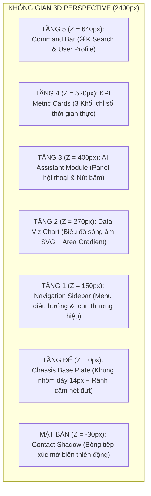

# BÁO CÁO AUDIT CHUYÊN SÂU: KỸ NGHỆ QUAY DỰNG ĐIỆN ẢNH PHÂN TÁCH 3D (3D EXPLODED-VIEW CINEMATOGRAPHY)
## TÀI LIỆU THAM CHIẾU QUỐC TẾ & KẾ HOẠCH ÁP DỤNG VÀO CẢNH 2 HỆ THỐNG TOPBAOHIEM

> **Nguồn video mẫu:** [Vincentwei1021/video-shotcraft - Exploded View](https://vincentwei1021.github.io/video-shotcraft/media/exploded-view.mp4?v=1790980736870)  
> **Mã nguồn gốc đối chiếu:** [`demos/camera/space-camera-moves/ExplodedView.tsx`](file:///Users/phamminhtri/Desktop/project/video-shotcraft/demos/camera/space-camera-moves/ExplodedView.tsx)  
> **Vị trí lưu trữ tài liệu:** [`docs/audits/scene2/audit_exploded_view_cinematography.md`](file:///Users/phamminhtri/Desktop/project/quancao-topbaohiem/docs/audits/scene2/audit_exploded_view_cinematography.md)  
> **Mục đích:** Bóc tách toàn diện từng khung hình, góc quay camera, cơ chế 3D hóa mô hình và vật lý phân tách để áp dụng trực tiếp cho giao diện website phần mềm TOPBAOHIEM trong Phân cảnh 2.

---

## I. TỔNG QUAN TRIẾT LÝ THIẾT KẾ: "APPLE KEYNOTE EXPLODED ARCHITECTURE"

Video mẫu không sử dụng hiệu ứng trượt 2D phẳng hay các slide thông thường. Thay vào đó, nó đại diện cho đỉnh cao nghệ thuật quay dựng quảng cáo phần mềm (Software Cinematography) thường thấy trong các buổi lễ ra mắt sản phẩm của Apple, Linear, Raycast:

```
┌──────────────────────────────────────────────────────────────────────────────────────────────────┐
│ TRIẾT LÝ: "MỔ XẺ CHO KHÁN GIẢ XEM" (DISSECT & REVEAL)                                            │
├──────────────────────────────────────────────────────────────────────────────────────────────────┤
│ 1. Trục đo 3/4 (3/4 Axonometric Isometric View): Toàn bộ trang web phẳng được đặt nằm nghiêng    │
│    trong không gian 3D như một "bo mạch chủ" / phiến đá công nghệ nguyên khối đặt trên mặt bàn. │
│ 2. Nhấc bổng theo pháp tuyến (Normal Elevation): Các mảnh ghép giao diện không bay tán loạn mà   │
│    nhấc thẳng đứng dọc theo trục Z (pháp tuyến bề mặt), phân chia thành nhiều tầng cao độ.       │
│ 3. Dấu vết vật lý (Ghost Sockets): Trên mặt đế vẫn giữ nguyên đường viền nét đứt của từng linh   │
│    kiện, giúp người xem luôn nhận thức được vị trí gốc và mối liên kết logic của toàn hệ thống. │
│ 4. Thị sai góc quay (Camera Orbit Parallax): Khi camera di chuyển, các tầng ở cao độ Z khác nhau│
│    trôi lệch vận tốc, tạo ra cảm giác chiều sâu không gian quang học chân thực 100%.             │
│ 5. Hợp thể đóng nắp (Reverse Assembly & Thud): Các mảnh ghép đóng ngược lại với gia tốc vật lý,  │
│    kết thúc bằng cú nén lún toàn hệ thống (8px damped recoil) và vệt quét sáng quang học.        │
└──────────────────────────────────────────────────────────────────────────────────────────────────┘
```

---

## II. BẢN ĐỒ THÔNG SỐ VẬN HÀNH & HỆ QUY CHIẾU CAMERA RIG 3D

Toàn bộ chuyển động trong video mẫu được vận hành trên không gian phối cảnh 3 chiều (`perspective: 2400px`, `transformStyle: 'preserve-3d'`):

### 1. Hệ Trục Tọa Độ Camera Rig (3-Axis Camera Choreography)
Trọng tâm camera liên tục biến thiên theo 5 thông số toán học:
$$\text{Camera}(f) = \{ \text{Pitch } (rx), \text{ Roll/Yaw } (rz), \text{ Scale } (s), \text{ CenterX } (cx), \text{ CenterY } (cy) \}$$

| Giai đoạn Timeline | Khung Frame | Trục Pitch ($rx$) | Trục Roll/Yaw ($rz$) | Tỷ lệ Zoom ($s$) | Độ dời Camera ($cx, cy$) | Ý đồ nghệ thuật đạo diễn |
| :--- | :--- | :--- | :--- | :--- | :--- | :--- |
| **1. Thiết lập & Tích lực** | `0 – 24` | $54.0^\circ$ | $-34.0^\circ \rightarrow -32.0^\circ$ | `0.56x` | $cx = -20\text{px}$, $cy = 40\text{px}$ | Giới thiệu giao diện hợp nhất hoàn chỉnh. Khung máy hơi lún $-6\text{px}$ tại frame 18–24 để蓄力 (tích lực bung nổ). |
| **2. Bùng nổ phân tầng** | `24 – 62` | $54.0^\circ \rightarrow 52.0^\circ$ | $-32.0^\circ \rightarrow -28.0^\circ$ | `0.56x` $\rightarrow$ **`0.47x`** | $cy = 40\text{px} \rightarrow \mathbf{180\text{px}}$ | **Camera tự động lùi xa và chúc xuống**: Nhường không gian hiển thị cho tầng cao nhất ($Z = 640\text{px}$) không bị tràn ra khỏi khung hình. |
| **3. Trôi quỹ đạo thị sai** | `62 – 104`| $52.0^\circ \rightarrow \mathbf{50.0^\circ}$ | $-28.0^\circ \rightarrow \mathbf{-22.0^\circ}$ | `0.47x` | Giữ ổn định trung tâm | **Camera Orbit Smooth**: Góc xoay quét một vòng cung $10^\circ$, phô diễn thị sai đa tầng. Các đường dẫn Callout bắn tia chỉ dẫn. |
| **4. Rút lui & Hợp thể** | `104 – 132`| $50.0^\circ \rightarrow 54.0^\circ$ | $-22.0^\circ \rightarrow -32.0^\circ$ | `0.47x` $\rightarrow$ **`0.56x`** | $cy = 180\text{px} \rightarrow 40\text{px}$ | Callout biến mất. Camera tiến lại gần khi các tầng rơi tự do ngược chiều về khay cắm. |
| **5. Cú nén tiếp đất & Quét sáng**| `132 – 142`| $54.0^\circ$ | $-32.0^\circ$ | `0.56x` | $cy = 40 + \mathbf{thud}(f)$ | **Cú đập búa (Thud)**: Toàn bộ cụm lún $8\text{px}$ đàn hồi. Vệt sáng Glaze Sheen quét qua bề mặt hoàn thiện. |
| **6. Khóa Poster thương hiệu** | `142 – 170`| $54.0^\circ$ | $-32.0^\circ$ | `0.56x` $\rightarrow$ `0.58x` | $cx = \mathbf{+190\text{px}}$, $cy = \mathbf{110\text{px}}$ | **Camera lia mạnh sang phải**: Dành trọn vẹn 50% không gian bên trái cho Logo và Headline xuất hiện uy nghi. |

---

## III. GIẢI MÃ CƠ CHẾ 3D HÓA MÔ HÌNH & PHÂN TÁCH MẢNH GHÉP (ANATOMY OF 3D LAYERS)

Bản chất của hiệu ứng "Exploded View" là **phân tách 1 giao diện phẳng thành hệ thống 6 tầng không gian có vật lý và đổ bóng độc lập**:



### 1. Tầng Đế: Bo mạch & Khung đỡ cơ khí (Chassis Base Plate)
* **Kích thước nền tảng:** $1600 \times 1000\text{px}$, bo góc $R = 26\text{px}$.
* **Khối dày 3D (Extruded Depth):** Một lớp viền màu xám kim loại `#c9d3e6` đặt lùi tại trục `translateZ(-14px)` tạo cảm giác tấm đế là một khối nhôm phay CNC dày $14\text{px}$.
* **Khay cắm nét đứt (Ghost Slots):**
  * Mỗi linh kiện khi bay lên để lại một ô rãnh nét đứt `border: 3px dashed rgba(47, 91, 255, 0.28)`, nền phát quang nhẹ `rgba(47, 91, 255, 0.03)`.
  * Khẳng định tính chính xác cơ học: mọi mảnh ghép đều có chỗ cắm xác định, không phải đồ họa ngẫu hứng.
* **Bóng tiếp xúc mặt bàn (Table Contact Shadow):**
  * Tọa độ `translateZ(-30px) translate(30px, 40px)`.
  * Khi các tầng bay lên cao $\rightarrow$ Diện tích bóng lan rộng và mờ đi (`blur: 40px`, `opacity: 0.20`).
  * Khi các tầng tiếp đất đóng sầm $\rightarrow$ Bóng co lại tức thì (`blur: 30px`, `opacity: 0.34`), tạo cảm giác "chạm đất đanh thép".

### 2. Kỹ thuật Đổ bóng Chiếu Xuống Đế (Cast Shadows on Base Plate)
Đây là bí mật tạo nên sự khác biệt giữa video 3D chuyên nghiệp và video 2D giả 3D:
* Từng mảnh ghép khi bay lên trục $Z$ (`h = ly.z * p`) đều tạo ra một bóng đen chiếu thẳng xuống mặt đế tại `translateZ(1px)`.
* **Hướng sáng nguồn (Key Light):** Nguồn sáng đặt ở góc trên bên trái (`36% X, 5% Y`), do đó bóng đổ trượt về góc dưới bên phải:
  $$\text{Shadow } X = \text{Layer } X + h \times 0.18, \quad \text{Shadow } Y = \text{Layer } Y + h \times 0.26$$
* **Độ nhòe và độ trong suốt quang học:**
  $$\text{Blur} = 10\text{px} + (h \times 0.09)\text{px}, \quad \text{Opacity} = 0.8 - \frac{h}{1400}$$
  *Khi tầng càng bay lên cao ($h$ lớn), bóng càng trượt xa ra khỏi đế, càng nhòe to và mờ dần đúng chuẩn quy luật tán xạ ánh sáng tự nhiên.*

### 3. Mép Cạnh Độ Dày Vật Lý Của Từng Mảnh Ghép (Extruded Thickness)
* Mọi mảnh ghép khi bay lên không phải là một tấm ảnh PNG mỏng dính.
* Phía dưới mỗi mảnh ghép được đệm một lớp mặt đáy màu xám xanh `#b9c6de` tại độ cao `translateZ(z - 8px)`, tạo ra độ dày cơ học $8\text{px}$ như một phiến kính cường lực/acrylic cao cấp.
* Viền trên cùng được bọc ánh sáng trắng `boxShadow: 0 0 0 2px rgba(255,255,255, 0.9)` bừng sáng khi bắt đầu bay lên.

---

## IV. ĐỘT PHÁ TOÁN HỌC: HỆ THỐNG CHÚ THÍCH CHIẾU 3D $\rightarrow$ 2D (DYNAMIC PROJECTED CALLOUTS)

Điểm nhấn thị giác mang tính biểu tượng của video chính là các đường chỉ dẫn kỹ thuật số (Technical Callouts) xuất hiện trong lúc các tầng đang lơ lửng:

```
                  ┌─────────────────────────────────────────────────────────┐
                  │ 04  LIVE METRICS                                        │
                  │ Updated every second                                    │
                  └────────────────────────┬────────────────────────────────┘
                                           │  (Đường nối gãy khúc SVG)
                                           │
                                           o ◄── Điểm neo 3D bám sát góc thẻ
                                        ┌───────┐
                                       ╱       ╱│  (Thẻ KPI Card lơ lửng ở Z=520)
                                      ┌───────┐ │
                                      │  KPI  │ ┘
                                      └───────┘
```

### 1. Thuật toán Chiếu Tọa Độ 3D sang 2D Màn Hình (`project()`)
Để đường chỉ dẫn luôn dính chặt vào góc của linh kiện 3D trong khi camera vẫn đang xoay vòng quanh, mã nguồn áp dụng ma trận biến đổi phối cảnh đồng nhất với CSS 3D Matrix:
```ts
const project = (c: Cam, px: number, py: number, pz: number) => {
  const X = px - W / 2, Y = py - H / 2;
  const a = (c.rz * Math.PI) / 180, b = (c.rx * Math.PI) / 180;
  // Biến đổi xoay theo góc máy quay RZ và RX
  const x1 = X * Math.cos(a) - Y * Math.sin(a);
  const y1 = X * Math.sin(a) + Y * Math.cos(a);
  const y2 = y1 * Math.cos(b) - pz * Math.sin(b);
  const z2 = y1 * Math.sin(b) + pz * Math.cos(b);
  // Nhân hệ số phối cảnh Perspective
  const k = PERSP / (PERSP - z2);
  return { 
    x: 960 + (x1 * c.s + c.cx) * k, 
    y: 540 + (y2 * c.s + c.cy) * k 
  };
};
```
*Kết quả:* Điểm neo (Anchor Dot) di chuyển theo thời gian thực chính xác đến từng sub-pixel theo mép của linh kiện.

### 2. Kỹ thuật Kẻ Đường Dẫn Vector & Typography Callout
* **Tia kẻ SVG tự động vẽ (`strokeDashoffset`):** Đường dẫn kẻ từ điểm neo trên thẻ 3D $\rightarrow$ vươn ngang ra mép màn hình $\rightarrow$ gấp khúc một góc sang trọng nối vào cụm chữ.
* **Bố cục 2 Cột (Dual Column Alignment):**
  * Mảnh ghép bên trái nối sang cột trái (`COL.L = 470px`, căn phải).
  * Mảnh ghép bên phải nối sang cột phải (`COL.R = 1450px`, căn trái).
* **Phân cấp Typography chuẩn Apple:**
  * Tag số thứ tự: `01`, `02`, `03` (Font Mono, đậm, màu Accent Cobalt).
  * Tên phân hệ tính năng: Font chữ 44px, độ đậm 760 sắc sảo.
  * Lời giải trình giá trị: Font chữ 30px, tone xám thanh lịch.

---

## V. NGHỆ THUẬT VẬT LÝ VA CHẠM: NÉN LÚN HỒI ĐÀN & QUÉT SÁNG (PHYSICAL WEIGHT & IMPACT)

Quy tắc bất biến trong repo `video-shotcraft`: **"Nói không với rung lắc camera giả tạo (No screen shake)"**. Độ chân thực đến từ phản lực vật lý nội tại của chính mô hình:

### 1. Hàm Nén Lún Tắt Dần Của Cú Đập Búa (Hammer Thud Formula)
Khi tầng cuối cùng đóng sập xuống tại frame `134`, toàn bộ hệ thống chịu xung lực nén lún $8\text{px}$ và nảy hồi tắt dần theo hàm mũ cosin:
$$\text{Thud}(t) = 8 \cdot e^{-t / 3} \cdot \cos(t \cdot 0.9) \quad (\text{với } t = f - 134 \ge 0)$$
* **Frame 134:** Lún xuống tối đa $-8\text{px}$.
* **Frame 137:** Nảy ngược lên $+3.2\text{px}$.
* **Frame 140:** Lún nhẹ $-1.1\text{px}$.
* **Frame 143:** Ổn định tuyệt đối về $0\text{px}$.
*Cảm giác đem lại:* Giống như một cánh cửa xe hơi hạng sang đóng sập "phập" một tiếng đầm chắc, đắt tiền và dứt khoát.

### 2. Vệt Sáng Quang Học (Glaze Sheen Sweep)
* Ngay sau khi dao động nén lún tắt hẳn (`frame 136 – 160`), một vệt sáng gradient tuyến tính trắng bạc quét chéo góc $20^\circ$ qua toàn bộ bề mặt bo mạch.
* Vệt sáng được cắt ngọt ngào theo đúng viền bo góc $R = 26\text{px}$ của đế, như một lời khẳng định ngầm: *"Mọi mắt xích đã được khóa chặt vào một cỗ máy hoàn hảo"*.

---

## VI. BẢN THIẾT KẾ ÁP DỤNG TRỰC TIẾP CHO CẢNH 2 HỆ THỐNG TOPBAOHIEM

Áp dụng toàn bộ ngôn ngữ quay dựng 3D Exploded-View này vào Cảnh 2 của TOPBAOHIEM (`Scene2_TopBaoHiemShowcase.tsx`), chúng ta sẽ nâng tầm giao diện phẳng thành một sân khấu kiến trúc InsurTech đỉnh cao:

```
┌──────────────────────────────────────────────────────────────────────────────────────────────────┐
│ CẢNH 2: 3D EXPLODED SHOWCASE HỆ SINH THÁI TOPBAOHIEM                                             │
├──────────────────────────────────────────────────────────────────────────────────────────────────┤
│ • Tiếp nhận Cảnh 1: Từ vầng sáng Hyperdrive Warp Portal đáp xuống bề mặt 3D nghiêng 3/4.        │
│ • Góc máy: rotateX: 52°, rotateZ: -28°, perspective: 2400px.                                     │
│ • Tầng 0 (Đế): Khung màn hình MacBook Retina & Khung nền web TOPBAOHIEM với 5 rãnh cắm nét đứt. │
│ • Tầng 1 (Z = 160px): Thanh Navigation Bar & Bộ nhận diện thương hiệu (Logo hồng, Khóa bảo mật).│
│ • Tầng 2 (Z = 320px): Cụm 5 Thẻ Bảo Hiểm Chủ Lực (Xe máy, Ô tô, Sức khỏe, Du lịch, Cháy nổ).     │
│ • Tầng 3 (Z = 460px): Động cơ AI OCR Quét Cà Vẹt & Bộ So Sánh Đa Hãng 15+ Công Ty.              │
│ • Tầng 4 (Z = 600px): Chiếc Khiên Bảo Vệ 3D & 3 Badge Trụ Cột Giá Trị (30s, 40%, An toàn).      │
│ • Đồng hành (Z = 720px): Thiết bị iPhone 3D trôi lơ lửng bên cạnh (Trải nghiệm đa nền tảng).    │
│ • Chú thích kỹ thuật số: 4 Callout bắn tia phát quang giải thích từng công nghệ lõi.            │
│ • Đóng nắp: Toàn bộ hợp thể đóng sập với xung lực Thud 8px + Vệt sáng Glaze Sheen quét qua.     │
└──────────────────────────────────────────────────────────────────────────────────────────────────┘
```

### 1. Phân Tầng Chi Tiết Cho Hệ Sinh Thái TOPBAOHIEM

| Tầng Layer | Cao độ Trục Z | Thành phần Giao diện TOPBAOHIEM | Callout Chú thích Chiếu 3D |
| :--- | :--- | :--- | :--- |
| **Layer Đế (Base Plate)** | $Z = 0\text{px}$ | Khung hiển thị MacBook Pro viền kim loại, bề mặt nền ấm `#FAF9F6`, 5 khay cắm rãnh nét đứt màu hồng thương hiệu `rgba(225, 29, 72, 0.25)`. | — |
| **Layer 1: Identity & Nav** | $Z = 160\text{px}$ | Header chính thức: Logo TOPbaohiem, Menu Sản phẩm, Tra cứu bồi thường, Nút Đăng nhập/Đăng ký. | `01 · NỀN TẢNG SỐ` / *Khởi đầu thông minh từ trang chủ* |
| **Layer 2: 5 Thẻ Sản Phẩm** | $Z = 320\text{px}$ | 5 Khối thẻ bảo hiểm bo góc với icon 3D nổi bật: Xe máy TNDS, Ô tô vật chất, Sức khỏe gia đình, Du lịch quốc tế, Cháy nổ doanh nghiệp. | `02 · DANH MỤC TOÀN DIỆN` / *5 nhóm giải pháp bảo vệ thiết yếu* |
| **Layer 3: Core Tech Engines** | $Z = 460\text{px}$ | Phân mảnh công nghệ đột phá: **AI OCR quét Cà vẹt xe 2 giây** + Ma trận biểu phí so sánh trực diện 15+ hãng lớn (Bảo Việt, PVI, PTI, PJICO...). | `03 · AI & SO SÁNH ĐA HÃNG` / *Minh bạch quyền lợi và biểu phí trong 30s* |
| **Layer 4: Trust & Security**| $Z = 600\text{px}$ | **Chiếc khiên 3D hồng phát quang** + 3 Badge trụ cột: "So sánh dễ dàng", "Tối ưu chi phí 40%", "Bảo mật dữ liệu chuẩn Bộ Công Thương". | `04 · AN TÂM TUYỆT ĐỐI` / *Hợp đồng điện tử QR hợp pháp tức thì* |
| **Layer Vệ Tinh: Mobile 3D** | $Z = 720\text{px}$ | Chiếc iPhone 15 Pro lơ lửng góc phải hiển thị phiên bản Mobile Responsive mượt mà đồng bộ theo thời gian thực. | `05 · LIỀN MẠCH ĐA NỀN TẢNG` / *Trải nghiệm 1-chạm trên Laptop & Mobile* |

---

## VII. KẾT LUẬN & ĐỀ XUẤT HÀNH ĐỘNG TIẾP THEO

Bản mẫu `exploded-view` từ repo `video-shotcraft` là chìa khóa hoàn hảo để biến Cảnh 2 của chúng ta thành một thước phim công nghệ đẳng cấp thế giới. 

### Các bước sẵn sàng phối hợp cùng Người dùng (Art Director):
1. **Bước 1 (Đã hoàn tất):** Báo cáo kiểm toán và phân tích toàn diện cơ chế kỹ thuật của `exploded-view` đã được lưu trữ an toàn tại [`docs/audits/scene2/audit_exploded_view_cinematography.md`](file:///Users/phamminhtri/Desktop/project/quancao-topbaohiem/docs/audits/scene2/audit_exploded_view_cinematography.md).
2. **Bước 2 (Chờ chỉ đạo):** Thảo luận cùng bạn về việc chọn lọc các mảnh ghép UI cụ thể của TOPBAOHIEM và bóc tách tài nguyên (sử dụng Canva MCP / kho ảnh 4K chụp sâu).
3. **Bước 3 (Thực thi khi bạn duyệt):** Lập trình component `ExplodedViewTOPbaohiem3D.tsx` thay thế cho placeholder phẳng hiện tại trong `Scene2_TopBaoHiemShowcase.tsx`.
